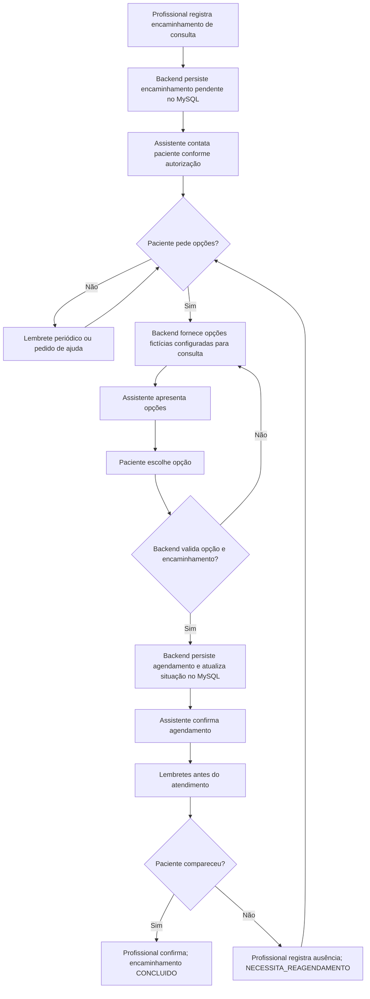
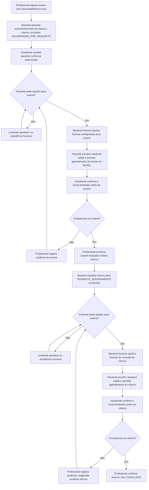
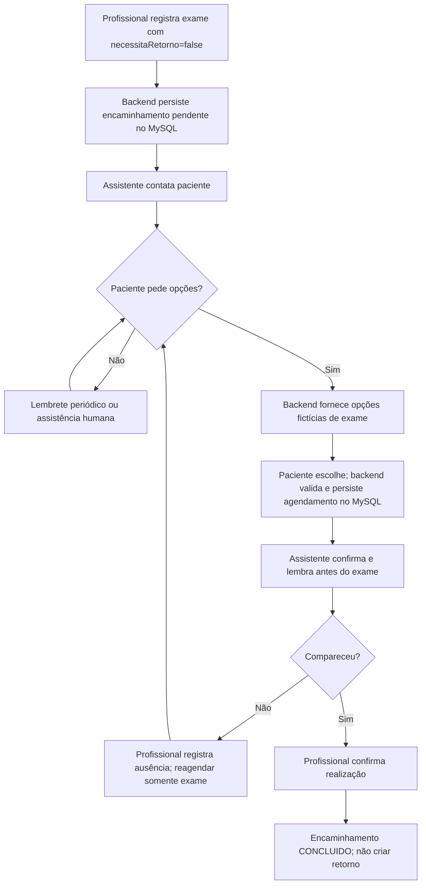
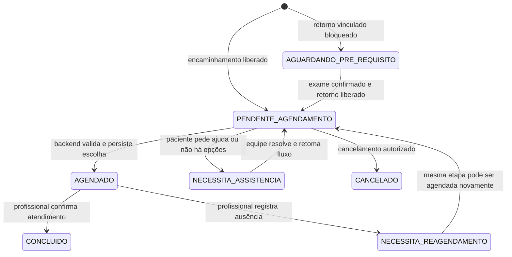
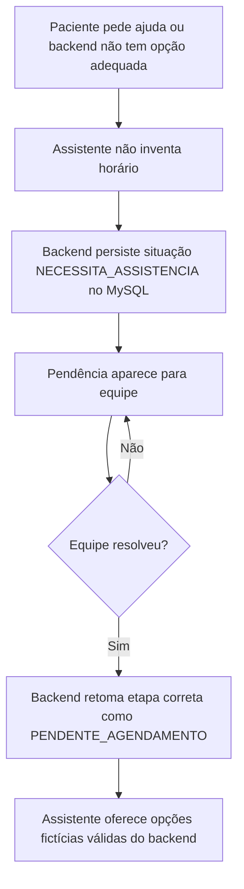

# Zelo — Fluxos do sistema

Os estados e registros de negócio descritos abaixo são persistidos no MySQL. As opções de data e horário são fictícias e vêm de configuração no backend, diferenciadas por procedimento; não há agenda real nem gestão de vagas. Consulte [`SPEC.md`](SPEC.md) para requisitos e regras completas.

## 1. Encaminhamento para consulta

## 2. Encaminhamento para exame com retorno obrigatório

**Regra:** falta ao retorno não reinicia nem exige repetir o exame. Apenas o encaminhamento do retorno volta à etapa de agendamento.

## 3. Exame sem retorno

## 4. Situações e transições

Para encaminhamentos com retorno, as transições se aplicam separadamente ao exame e ao retorno vinculado. A conclusão do exame nunca conclui o retorno.

## 5. Encaminhamento para atendimento humano

Se o atendimento humano ocorrer durante o fluxo de retorno, retomar o retorno; se ocorrer durante o exame, retomar o exame.

## 6. Lembretes e exceções

- Encaminhamento liberado sem agendamento: lembrete periódico a cada 15 dias, mediante autorização e respeito às regras do canal.
- Agendamento: lembretes 7 dias e 1 dia antes quando as datas forem futuras.
- Parar lembretes quando a etapa for agendada, concluída, cancelada ou mudar para uma etapa em que o lembrete deixou de ser aplicável.
- A demonstração pode disparar lembrete manual identificado como simulação; não requer infraestrutura complexa de mensageria.
- Sem opção configurada: informar que não há opção disponível e registrar assistência humana.
- Resposta ambígua: pedir esclarecimento; não registrar agendamento por suposição.
- Falha de canal: preservar encaminhamento e permitir demonstração do mesmo fluxo no chat.

## 7. Persistência

O backend registra encaminhamentos, agendamentos e mudanças de situação no MySQL 8.0+. A seleção de uma opção fictícia é validada e persistida pelo backend; o assistente só confirma após a resposta bem-sucedida. O esquema é evoluído por migrations Flyway em `src/main/resources/db/migration/`, e Hibernate valida o esquema. Opções mockadas permanecem configuração de backend, sem tabelas de agenda ou cadastro de unidade.

## 8. Login profissional

O profissional entra em /login com e-mail e senha. Após validar as credenciais, a conta, o perfil e o vínculo institucional, o backend cria a sessão e o frontend abre /dashboard. Ao recarregar, /api/auth/me revalida o acesso. Quando a sessão expira ou o profissional sai, a rota volta para /login.
