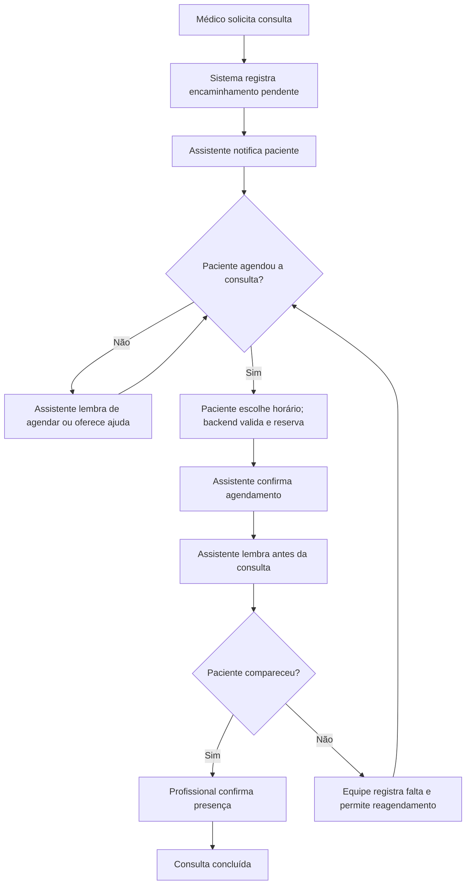
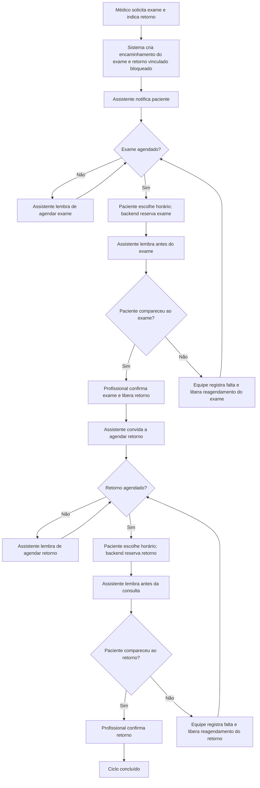

# Zelo — Fluxos do sistema

Este documento descreve as jornadas de consulta e exame com retorno, as exceções e a persistência dos estados. Para requisitos e regras de negócio, consulte [`SPEC.md`](SPEC.md).

## 1. Fluxo de agendamento de consulta

> No diagrama, “paciente agendou?” representa a decisão de agendar: a reserva só se torna válida no passo de confirmação do backend.

## 2. Fluxo de exame com retorno

**Regra central:** se o paciente faltar ao retorno, ele **não precisa repetir o exame**; retorna apenas ao agendamento da consulta. O retorno só é liberado após confirmação do exame e autorização do profissional.

## 3. Estados e transições

- `WAITING_PREREQUISITE` → `PENDING_SCHEDULING`: etapa anterior concluída e retorno liberado pelo profissional.
- `PENDING_SCHEDULING` → `SCHEDULED`: reserva confirmada no backend.
- `SCHEDULED` → `COMPLETED`: profissional confirma comparecimento.
- `SCHEDULED` → `NEEDS_RESCHEDULE`: profissional registra ausência.
- `NEEDS_RESCHEDULE` → `PENDING_SCHEDULING`: nova tentativa de marcação.
- `PENDING_SCHEDULING` → `NEEDS_ASSISTANCE`: paciente solicita ajuda ou não há vagas.
- `NEEDS_ASSISTANCE` → `PENDING_SCHEDULING`: equipe resolve bloqueio e retoma agendamento.
- Estados elegíveis → `CANCELLED`: cancelamento autorizado.

Uma ausência **não** conclui o encaminhamento. A reserva só é confirmada após validação e persistência pelo backend.

### Persistência dos fluxos — MySQL

- Persistir encaminhamentos, reservas, estados e confirmações no **MySQL 8.0+**.
- As informações devem permanecer disponíveis após reinicialização da aplicação.
- Utilizar **transação** para verificar e reservar vaga, evitando concorrência e duplicidade.
- Garantir integridade referencial entre paciente, procedimento, unidade, horário, encaminhamento e agendamento.

## 4. Lembretes

### Antes do agendamento

- Notificação inicial quando o encaminhamento é liberado.
- Lembretes de agendamento a cada **15 dias**, enquanto pendente, respeitando as regras do canal.
- Interrupção após agendamento, cancelamento ou encaminhamento para atendimento humano, conforme política definida.

### Depois do agendamento

- Lembretes **7 dias e 1 dia antes**, quando as datas ainda estiverem no futuro.
- Interrupção após conclusão, ausência ou cancelamento da reserva.

### Na demonstração

Permitir disparar manualmente um lembrete de teste, identificado como **simulação**, sem aguardar o tempo real.

## 5. Casos excepcionais

### Sem horário disponível

- Não inventar disponibilidade.
- Informar ao paciente que não existem vagas cadastradas no momento.
- Registrar necessidade de assistência humana.

### Paciente não consegue marcar

- Identificar pedido de ajuda.
- Alterar estado para `NEEDS_ASSISTANCE`.
- Exibir a pendência no dashboard.

### Paciente não comparece

- Profissional registra ausência.
- Reagendar **o mesmo procedimento**.
- Não recriar etapas já concluídas.

### Resposta ambígua

- Solicitar esclarecimento.
- Não confirmar reserva por suposição da IA.

### Falha no WhatsApp

- Registrar falha quando identificável.
- Preservar o encaminhamento.
- Disponibilizar o chat web para demonstrar o mesmo fluxo.

## 6. Encerramento do ciclo de exame com retorno

O ciclo é concluído somente quando:

1. Exame realizado e confirmado pelo profissional.
2. Retorno liberado e agendado.
3. Consulta de retorno realizada e confirmada pelo profissional.

Não inferir a realização de exames nem a liberação de resultados apenas com base em mensagens do paciente.
